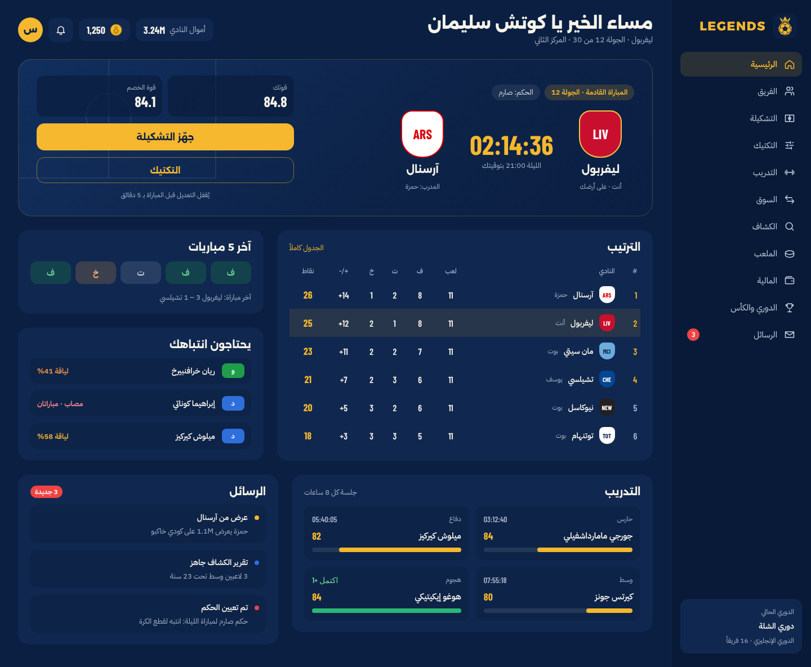
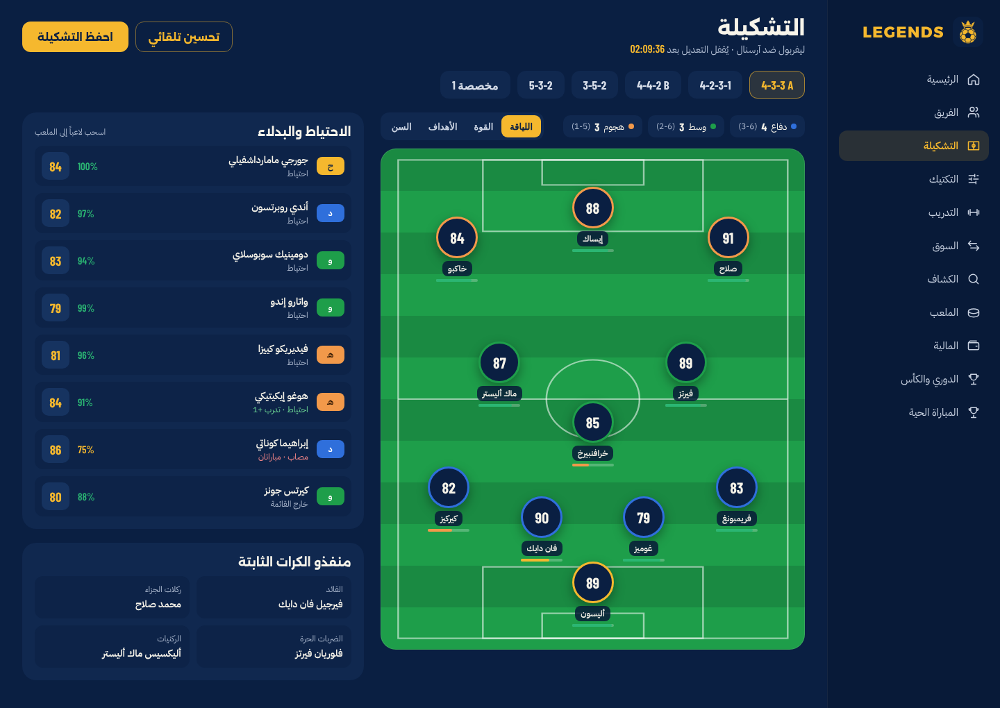
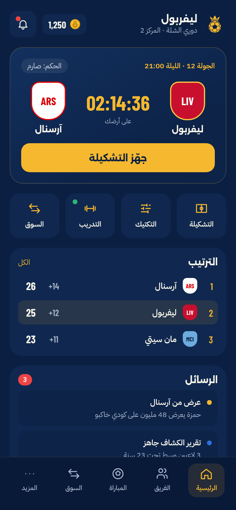
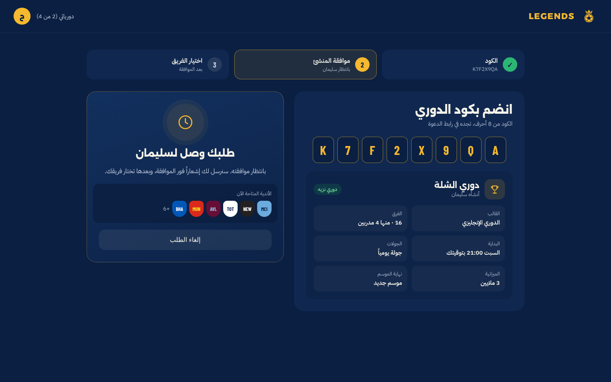
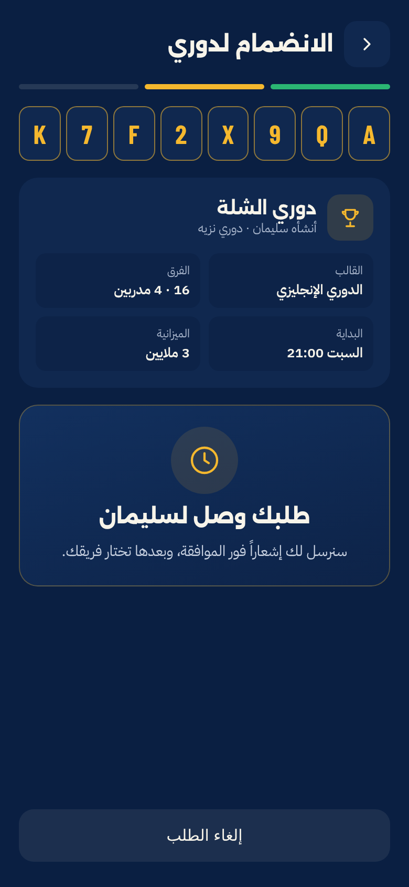
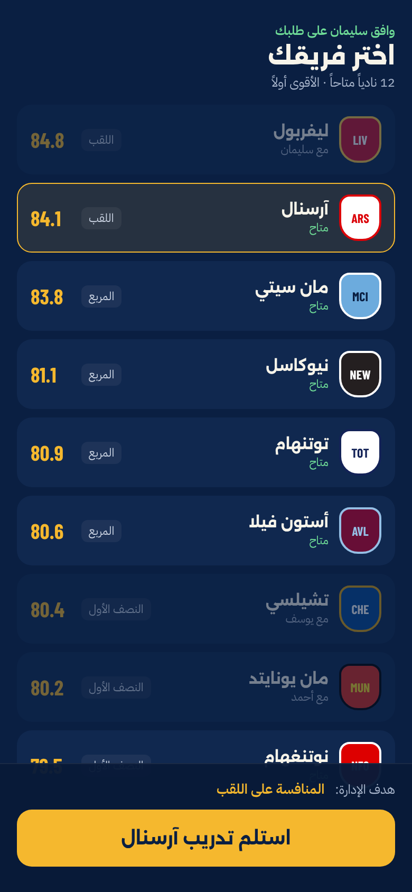
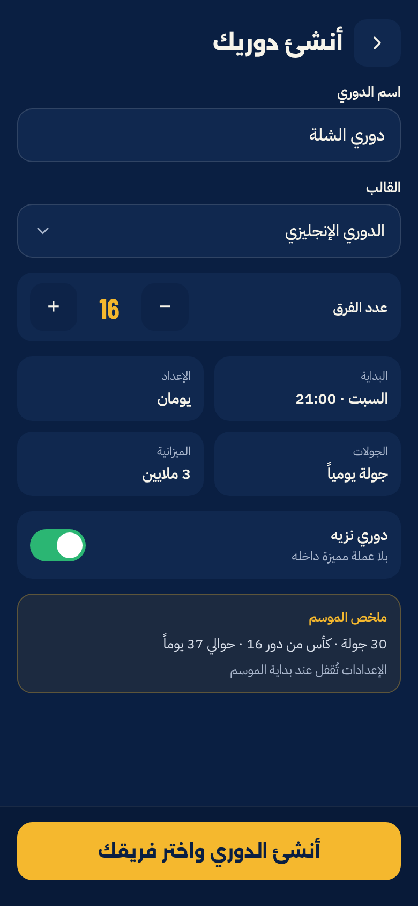

# تصاميم Legends

معاينة كل الشاشات كما تظهر في لوحة التصميم. **الحالة: مسودات للمراجعة قبل الاعتماد.**

| المجلد | المحتوى |
|---|---|
| `screens/png/` | صور الشاشات (هي المعروضة هنا) |
| `screens/*.html` | نفس الشاشات كصفحات ثابتة، تُفتح في المتصفح بعد استنساخ المستودع (`screens/index.html`) |
| `legends-ui/` | مصادر لوحة التصميم (`*.dc.html` و`canvas.json`) |
| `reference/` | لقطات OSM المرجعية (اختيارية) |

**إعادة التصدير بعد أي تعديل:**

```bash
node tools/design-export/render.mjs docs/design/legends-ui docs/design/screens
python3 tools/design-export/shoot.py docs/design/legends-ui/canvas.json docs/design/screens docs/design/screens/png
```

## نظام التصميم

### نظام التصميم


## الشاشات الأساسية · الويب

### الويب: الرئيسية



### الويب: التشكيلة



### الويب: المباراة الحية


## الشاشات الأساسية · الموبايل

| الرئيسية | التشكيلة | المباراة الحية |
|---|---|---|
|  |  |  |

## الدخول والانضمام · الويب

### الويب: تسجيل الدخول


### الويب: إنشاء حساب


### الويب: الانضمام لدوري



### الويب: اختيار الفريق


### الويب: إنشاء دوري


## الدخول والانضمام · الموبايل

| تسجيل الدخول | إنشاء حساب | الانضمام لدوري | اختيار الفريق | إنشاء دوري |
|---|---|---|---|---|
|  |  |  |  |  |

## ملاحظات

- الألوان والخطوط هنا هي المرجع لـ Tailwind في `web/` (السبرنت 1 للمحاكي، وكاملة في السبرنت 2).
- البيانات حقيقية من `data/ea-fc26/` (ليفربول وآرسنال)، والأسماء معروضة بالعربية.
- الويب: شريط جانبي. الموبايل: شريط سفلي بخمسة أقسام (الرئيسية، الفريق، المباراة، السوق، المزيد).
- شارات الأندية مولّدة من ألوان النادي وحروفه، بدل الشعارات الحقيقية.
