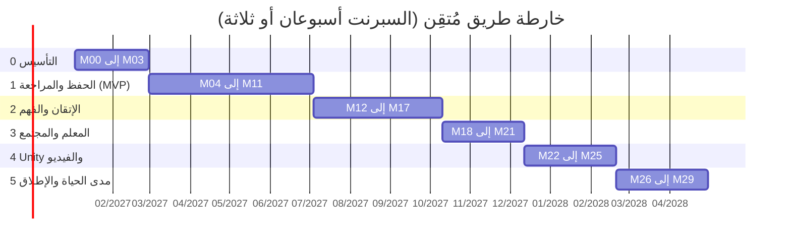

# مُتقِن: منصة حفظ القرآن الكريم وإتقانه وتعاهده مدى الحياة

> «مُتقِن» اسم عمل مقترح، والاسم النهائي قرار صاحب المشروع (القسم 8).
> هذا المجلد خطة فقط: لا كود فيه بعد. وهو مشروع مستقل عن GLM، ومكانه هنا مؤقت حتى يُنشأ له مستودعه (Sprint M01).

## 1. الفكرة في سطور

منصة واحدة (ويب، وجوال، وعالم ثلاثي الأبعاد) ترافق الحافظ من أول آية يحفظها إلى آخر يوم في عمره، وتجيب كل يوم عن سؤال واحد: **«ماذا أقرأ اليوم، وكيف أتأكد أني أتقنته؟»**

| الركن | ما تقدمه المنصة |
|---|---|
| **الحفظ** | جلسة حفظ جديدة بالتلقين والتكرار والربط، بالصوت والكتابة والنظر |
| **الإتقان** | تسميع آلي يتابعك كلمة بكلمة ويكشف الخطأ والتردد، وبوابة إتقان لا تُفتح إلا بتسميع بلا خطأ |
| **المراجعة والتثبيت** | ذاكرة لكل آية تحسب متى تضعف، فتعيدها إليك قبل أن تُنسى |
| **التعاهد** | ورد مراجعة دائم للحافظ بعد الختم (ختمة كل 7 أو 10 أو 30 يوماً) لا ينتهي |
| **الفهم والتدبر** | معاني الكلمات، وتفسير ميسر، ومقاصد السور، ودفتر تدبر |
| **المتابعة** | معلم وحلقة وولي أمر، وتقارير دورية، واختبارات تحاكي اللجان |
| **الرفيق** | مساعد ملازم يبني الخطة ويعدّلها مع ظروف حياتك ولا يتركك |

## 2. ملفات الخطة

| الملف | ما فيه |
|---|---|
| [`docs/01-methodology.md`](docs/01-methodology.md) | المنهج التربوي: دورة الحفظ، ونموذج الذاكرة، وبوابة الإتقان، وأنواع الأخطاء |
| [`docs/02-features.md`](docs/02-features.md) | كتالوج المزايا كلها (صوتي، وكتابي، وبصري، واجتماعي) |
| [`docs/03-architecture.md`](docs/03-architecture.md) | البنية التقنية: Laravel وVue وPython وFlutter وUnity، والمخططات |
| [`docs/04-data-model.md`](docs/04-data-model.md) | نموذج البيانات (ERD) وعقد الـ API |
| [`docs/05-ai-services.md`](docs/05-ai-services.md) | خدمات Python: التسميع الآلي، والمحاذاة، والتجويد، والمتشابهات |
| [`docs/06-web-design.md`](docs/06-web-design.md) | خريطة الويب ومخططات شاشاته |
| [`docs/07-mobile-design.md`](docs/07-mobile-design.md) | خريطة التطبيق ومخططات شاشاته والعمل بلا إنترنت |
| [`docs/08-unity.md`](docs/08-unity.md) | عالم الرحلة، ومجسم مخارج الحروف، وألعاب الأطفال |
| [`docs/09-video-studio.md`](docs/09-video-studio.md) | استوديو الفيديو الآلي (المونتاج) |
| [`docs/10-content-and-trust.md`](docs/10-content-and-trust.md) | مصادر النص والتلاوات والتفاسير، والمراجعة الشرعية، والخصوصية |
| [`sprints/`](sprints/) | 31 سبرنت (M00 إلى M30)، ملف لكل واحد |

## 3. المبادئ التي لا تُكسر

1. **النص القرآني مقدس:** لا يُولَّد حرف من القرآن بنموذج لغوي أبداً. النص يأتي من قاعدة بيانات موثقة مطابقة لمصحف المدينة، بفحص بصمة (checksum) عند كل بناء.
2. **الآلة تنبّه والمعلم يحكم:** التسميع الآلي «تنبيه آلي» وليس حكماً نهائياً، وللقارئ أن يعترض عليه. والإجازة والسند من معلم مجاز فقط، لا من المنصة.
3. **لا فتوى ولا تفسير بالرأي:** المساعد يجيب في التفسير والمعاني من كتب معتمدة مع ذكر المصدر، وما عداها يحيل فيه إلى أهل العلم.
4. **لا جديد حتى يثبت القديم:** إذا تراكمت المراجعة توقف الحفظ الجديد تلقائياً.
5. **الإتقان قبل الكم:** الصفحة لا تُحسب محفوظة حتى تمر من بوابة الإتقان.
6. **القليل الدائم:** الخطة تتكيف مع ظروف المستخدم ولا تعاقبه، «أحب الأعمال إلى الله أدومها وإن قل».
7. **الوقار:** لا إعلانات، ولا موسيقى، ولا تلعيب يجرّ إلى الرياء. المنافسة اختيارية وداخل الحلقة.
8. **الخصوصية:** التسجيلات الصوتية ملك صاحبها، وتسجيلات النساء لا تصل إلا إلى معلمات.
9. **يعمل بلا إنترنت:** الحفظ والمراجعة والتسميع على الجوال بلا اتصال.
10. **مجاني ومفتوح الأدوات:** كل المكتبات والنماذج مجانية وتُستضاف على خادمنا.

## 4. المنصات والتقنيات

| الطبقة | التقنية | دورها |
|---|---|---|
| الخادم | **Laravel 12** وPostgreSQL وRedis وReverb | الحسابات، والخطط، ونموذج الذاكرة، والحلقات، والـ API |
| الويب | **Vue 3** وTypeScript وVite وPinia | المصحف، والجلسات، ولوحة المعلم والإدارة |
| الذكاء | **Python** (FastAPI وPyTorch وONNX) | التسميع الآلي، والمحاذاة، والتجويد، والمتشابهات، والفيديو |
| الجوال | **Flutter** (Android وiOS) | كل شيء بلا إنترنت، وتسميع على الجهاز |
| ثلاثي الأبعاد | **Unity** (WebGL وداخل Flutter) | عالم الرحلة، ومجسم المخارج، وألعاب الأطفال |
| الفيديو | **FFmpeg** وPython (MoviePy وManim) وBlender | مونتاج آلي لمقاطع الآيات والدروس وملخصات التقدم |

## 5. خارطة الطريق

التواريخ تقديرية لفريق صغير (مطوّر مع Claude ومراجع)، وتتغير بقرار صاحب المشروع. المجموع نحو 69 أسبوعاً حتى الإطلاق العام (M29)، وM30 مستمر بعده.

## 6. جدول السبرنتات

| # | السبرنت | المرحلة | الحالة |
|---|---|---|---|
| M00 | [الاكتشاف والقرارات والتراخيص والمراجعة الشرعية](sprints/M00-discovery.md) | 0 | لم يبدأ |
| M01 | [الأساس التقني](sprints/M01-foundation.md) | 0 | لم يبدأ |
| M02 | [بيانات القرآن](sprints/M02-quran-data.md) | 0 | لم يبدأ |
| M03 | [نظام التصميم والمصحف القارئ](sprints/M03-design-system-mushaf.md) | 0 | لم يبدأ |
| M04 | [الحسابات والتهيئة وتحديد المستوى](sprints/M04-accounts-onboarding.md) | 1 | لم يبدأ |
| M05 | [محرك الخطط المرنة](sprints/M05-plan-engine.md) | 1 | لم يبدأ |
| M06 | [جلسة الحفظ الجديد](sprints/M06-new-hifz-session.md) | 1 | لم يبدأ |
| M07 | [نموذج الذاكرة ومحرك المراجعة](sprints/M07-memory-review.md) | 1 | لم يبدأ |
| M08 | [التسميع الآلي 1: التعرف والمحاذاة](sprints/M08-recitation-asr.md) | 1 | لم يبدأ |
| M09 | [التسميع الحي وخريطة الإتقان](sprints/M09-live-recitation-itqan.md) | 1 | لم يبدأ |
| M10 | [الحفظ الكتابي](sprints/M10-written-hifz.md) | 1 | لم يبدأ |
| M11 | [الرفيق 1 والإطلاق التجريبي](sprints/M11-companion-beta.md) | 1 | لم يبدأ |
| M12 | [المتشابهات](sprints/M12-mutashabihat.md) | 2 | لم يبدأ |
| M13 | [الاختبارات ومحاكاة اللجنة](sprints/M13-exams.md) | 2 | لم يبدأ |
| M14 | [الفهم: المعاني والتفسير ومقاصد السور](sprints/M14-understanding.md) | 2 | لم يبدأ |
| M15 | [التدبر والرفيق الذكي](sprints/M15-tadabbur-smart-companion.md) | 2 | لم يبدأ |
| M16 | [التجويد: الدروس والكشف الآلي](sprints/M16-tajweed.md) | 2 | لم يبدأ |
| M17 | [الجوال بلا إنترنت والتسميع على الجهاز](sprints/M17-offline-on-device.md) | 2 | لم يبدأ |
| M18 | [الحلقات والمعلم والتصحيح غير المتزامن](sprints/M18-halaqa-teacher.md) | 3 | لم يبدأ |
| M19 | [الجلسات المباشرة ومسار الإجازة](sprints/M19-live-sessions-ijazah.md) | 3 | لم يبدأ |
| M20 | [الأسرة والأطفال](sprints/M20-family-kids.md) | 3 | لم يبدأ |
| M21 | [رفيق الحفظ والمجموعات والمسابقات](sprints/M21-community.md) | 3 | لم يبدأ |
| M22 | [Unity 1: عالم الرحلة](sprints/M22-unity-journey.md) | 4 | لم يبدأ |
| M23 | [Unity 2: مجسم المخارج وألعاب التثبيت](sprints/M23-unity-makharij-games.md) | 4 | لم يبدأ |
| M24 | [استوديو الفيديو 1: مقاطع الآيات وملخص التقدم](sprints/M24-video-studio-1.md) | 4 | لم يبدأ |
| M25 | [استوديو الفيديو 2: الدروس والقوالب](sprints/M25-video-studio-2.md) | 4 | لم يبدأ |
| M26 | [التعاهد مدى الحياة](sprints/M26-lifelong-taahud.md) | 5 | لم يبدأ |
| M27 | [الروايات واللغات](sprints/M27-riwayat-languages.md) | 5 | لم يبدأ |
| M28 | [الوصول والأداء والأمان](sprints/M28-accessibility-performance-security.md) | 5 | لم يبدأ |
| M29 | [الإطلاق العام](sprints/M29-launch.md) | 5 | لم يبدأ |
| M30 | [ما بعد الإطلاق: تحسين النماذج والأجهزة](sprints/M30-post-launch.md) | 5 | لم يبدأ |

**أول نسخة يمكن استعمالها فعلاً:** نهاية M11 (حفظ، ومراجعة، وتسميع آلي، وكتابة، وخطة، ورفيق) على الويب وأندرويد.

## 7. مقاييس النجاح

| المقياس | الهدف |
|---|---|
| المداومة: مستخدمون أتموا وردهم 5 أيام من 7 | 60% من النشطين |
| الإتقان: صفحات مرت من بوابة الإتقان من المحفوظ | 85% |
| الثبات: نجاح التسميع بعد 30 يوماً من الحفظ | 90% |
| دقة التسميع الآلي: كشف أخطاء الكلمات (recall) | 95% على الأقل، وإنذار كاذب 3% على الأكثر |
| زمن رد التسميع الحي | أقل من 1.5 ثانية |
| العودة بعد انقطاع أسبوع | 50% يعودون بخطة «العودة» |

## 8. ما ينتظر قرار صاحب المشروع

1. **الاسم والدومين** (مُتقِن، أو غيره).
2. **الجهة الشرعية المراجِعة:** من يراجع النص والمحتوى ونتائج التسميع؟ (شيخ مجاز أو لجنة.)
3. **الرواية الأولى:** الخطة تفترض حفصاً عن عاصم بمصحف المدينة (604 صفحات)، وورش وقالون في M27.
4. **نموذج التمويل:** وقف مجاني كامل، أم مجاني مع اشتراك للحلقات المباشرة، أم تبرعات؟ (الخطة تفترض المجاني بلا إعلانات.)
5. **نموذج المساعد الذكي:** أي مزوّد للنموذج اللغوي (مجاني محدود، أو مدفوع، أو نموذج محلي على الخادم).
6. **الخادم:** نفس سيرفر Hostinger أم سيرفر مستقل؟ والتسميع الآلي يحتاج معالجاً قوياً أو كرت شاشة (التفاصيل في `docs/03-architecture.md`).
7. **جمع الأصوات لتحسين النماذج:** بموافقة صريحة من كل مستخدم، أم لا يُجمع شيء؟
8. **المستودع:** مستودع جديد مستقل (المقترح) أم داخل هذا المستودع؟
9. **ترتيب المراحل:** هل تتقدم Unity أو الفيديو على مرحلة المعلم؟
