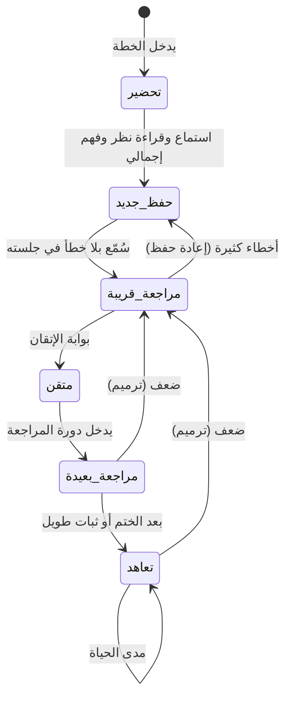

# 01. المنهج التربوي

كل ميزة في المنصة تخدم واحدة من خمس مراحل يمر بها كل مقطع محفوظ. هذا الملف هو المرجع الذي تُبنى عليه الخطط ونموذج الذاكرة والتسميع.

## 1. دورة حياة المقطع المحفوظ

| المرحلة | متى | ما يفعله الحافظ | ما تفعله المنصة |
|---|---|---|---|
| **التحضير** | قبل الحفظ بيوم وأسبوع | يسمع المقطع ويقرؤه نظراً ويعرف معناه | تلاوة مكررة، ومعاني الكلمات، وموضوع المقطع |
| **الحفظ الجديد** | جلسة اليوم | يحفظ آية آية ثم يربط | تلقين، وعدّاد تكرار، وإخفاء تدريجي، وتسميع |
| **المراجعة القريبة** | آخر 7 إلى 20 صفحة، يومياً | يسمّع المحفوظ حديثاً كل يوم | تسميع آلي وتسجيل الأخطاء |
| **المراجعة البعيدة** | كل المحفوظ، بدورة | جزء أو أكثر يومياً | نموذج الذاكرة يختار الأضعف أولاً |
| **التعاهد** | بعد الختم، مدى الحياة | ختمة مراجعة دورية، والقراءة في الصلاة | ورد ثابت مع ترميم ما ضعف |

هذه المراحل تجمع ما اتفقت عليه طرق التحفيظ المعروفة (الحصون الخمسة، وطريقة الألواح، والتكرار، والتلقين)، والمستخدم يختار «قالب الطريقة» في خطته (القسم 6).

## 2. جلسة الحفظ الجديد

خطوات الجلسة الافتراضية، وكلها قابلة للضبط:

1. **الاستماع:** المقطع كاملاً من قارئ متقن (3 مرات افتراضياً).
2. **الفهم الإجمالي:** معاني الكلمات الغريبة وجملة عن موضوع المقطع (دقيقة واحدة).
3. **القراءة نظراً:** يقرأ والمنصة تتابعه وتصحح تلاوته قبل أن يحفظ خطأً.
4. **الحفظ آية آية:** تكرار كل آية بعدد يحدده (افتراضياً 10 نظراً ثم 10 غيباً) مع إخفاء تدريجي للكلمات.
5. **الربط:** كل آية جديدة تُضم إلى ما قبلها (1، ثم 1+2، ثم 1+2+3).
6. **تسميع المقطع:** غيباً والمصحف مخفي. لا تنتهي الجلسة إلا بتسميع بلا خطأ.
7. **الكتابة (اختياري):** كتابة المقطع من الحفظ.
8. **الربط بما قبله:** آخر صفحة محفوظة مع الجديدة.

## 3. بوابة الإتقان

الصفحة لا تصير «متقنة» إلا إذا اجتمعت الشروط:

- تسميع كامل **بلا خطأ ولا تلقين** والمصحف مخفي،
- **في ثلاثة أيام مختلفة** (لا في جلسة واحدة)،
- واجتياز **سؤال عشوائي** منها («اقرأ من قوله تعالى...»)،
- وللمنتسب لحلقة: **اعتماد المعلم** إن اشترطه.

والأرقام إعدادات يغيّرها المعلم أو المستخدم (لا تقل عن تسميع واحد بلا خطأ).

## 4. أنواع الأخطاء

كل خطأ يُسجَّل برمزه وموضعه (سورة، آية، كلمة)، ومنه تُبنى خريطة الإتقان.

| الرمز | النوع | مثال | الوزن |
|---|---|---|---|
| `OMIT` | حذف كلمة أو أكثر | إسقاط كلمة من الآية | عالٍ |
| `SUB` | إبدال كلمة بأخرى | «غفور» مكان «عزيز» | عالٍ |
| `ADD` | زيادة | زيادة «و» | عالٍ |
| `ORDER` | تقديم وتأخير | قلب ترتيب كلمتين | عالٍ |
| `JUMP` | انتقال إلى آية متشابهة | يكمل من موضع آخر | عالٍ جداً (يدخل قائمة المتشابهات) |
| `HARAKA` | خطأ في الحركة (لحن جلي) | فتح مكان ضم | عالٍ |
| `STALL` | تردد أو توقف طويل | سكوت أكثر من 4 ثوانٍ | متوسط |
| `PROMPT` | طلب تلقين | ضغط «ذكّرني» | متوسط |
| `REPEAT` | إعادة للتذكر | يعيد الآية ليتذكر ما بعدها | خفيف |
| `TAJ-*` | خطأ تجويد (لحن خفي) | ترك غنة، قصر مد | خفيف في الحفظ، ومستقل في مسار التجويد |

## 5. نموذج الذاكرة

**الوحدة:** الآية (والآية الطويلة تُقسم على علامات الوقف)، وتُجمع إلى صفحة وربع وجزء.

لكل آية عند كل مستخدم:

- **الثبات** `stability`: عدد الأيام حتى ينزل احتمال استحضارها إلى الهدف.
- **الصعوبة** `difficulty`: تزيد بالأخطاء المتكررة والمتشابهات.
- **آخر تسميع** وعدد **السقطات**.
- **نقاط الضعف:** الكلمات التي أخطأ فيها ونوع الخطأ.

الأساس خوارزمية **FSRS** المفتوحة (التكرار المتباعد)، مع تكييفات خاصة بالقرآن:

| التكييف | السبب |
|---|---|
| **هدف الاستحضار 95% فأعلى** (لا 90%) | المطلوب إتقان لا تذكر تقريبي |
| **التقييم آلي من التسميع** | بلا خطأ = جيد، تردد = صعب، خطأ = إعادة. لا يقيّم المستخدم نفسه إلا إن سمّع بلا آلة |
| **المراجعة مقاطع متصلة** | الآيات المستحقة تُضم إلى صفحات وأرباع متصلة، لأن القرآن يُقرأ سرداً لا بطاقات متفرقة |
| **المفاصل عناصر مستقلة** | الربط بين آخر الصفحة وأول التي تليها، وبين السور، يُتابع وحده لأنه أكثر مواضع الانقطاع |
| **تداخل المتشابهات** | الخطأ `JUMP` يضعف الآيتين معاً ويجدول مراجعتهما متقابلتين |
| **سقف الحمل اليومي بالوقت** | المستخدم يحدد دقائقه، والمحرك يرتب بالأولوية: الأضعف، ثم القريب، ثم الجديد |
| **حد أدنى للدورة** | مهما قوي الثبات، لا تمر آية أكثر من مدة الدورة (30 يوماً افتراضياً) بلا قراءة |

**قاعدة الدَّين:** إذا تجاوزت المراجعة المتأخرة حداً (افتراضياً ورد يومين) يتوقف الحفظ الجديد حتى تُسدّ.

## 6. قوالب الطرق

| القالب | وصفه | لمن |
|---|---|---|
| **المتوازن** (افتراضي) | جديد + قريب + بعيد يومياً | أغلب المستخدمين |
| **الحصون الخمسة** | قراءة وسماع يومي، وتحضير أسبوعي وليلي وقبلي، وجديد، وقريب، وبعيد | المتفرغ نسبياً |
| **الألواح** | كتابة المقطع ثم حفظه من المكتوب ثم محوه | من يثبت بالكتابة |
| **التكرار المكثف** | تكرار عالٍ (20 إلى 40) بمقدار صغير | من يريد رسوخاً شديداً |
| **التثبيت أولاً** | بلا جديد: مراجعة وترميم فقط | من حفظ قديماً ونسي |
| **التعاهد** | ورد ختمة دورية | من ختم |
| **الصغار** | مقاطع قصيرة وتلقين وألعاب | دون 10 سنوات |

## 7. مسار الفهم

الفهم ملازم للحفظ لا مرحلة بعده:

1. **قبل الحفظ:** معاني الغريب وموضوع المقطع.
2. **مع الحفظ:** معنى كل كلمة بلمسة، وإعرابها اختيارياً.
3. **بعد الحفظ:** التفسير الميسر، وسبب النزول إن وُجد، وسؤالان للفهم.
4. **على مستوى السورة:** بطاقة السورة (مقصدها، ومحاورها، وخريطة موضوعاتها) تعين على الحفظ بالترابط.
5. **التدبر:** دفتر يكتب فيه المستخدم ما وقف عنده، مربوطاً بالآية.
6. **مفردات القرآن:** مسار للكلمات الأكثر تكراراً حتى يفهم غير المتخصص أغلب ما يقرأ.

## 8. المتابعة الدورية

| الدورية | ما يحدث |
|---|---|
| يومياً | الورد، وملخص الجلسة (دقائق، وأخطاء، وما ثبت) |
| أسبوعياً | تقرير: الالتزام، والصفحات المتقنة، وأضعف المواضع، واقتراح تعديل الخطة |
| شهرياً | اختبار شامل لما حُفظ في الشهر، ومراجعة الخطة |
| كل جزء | اختبار جزء (5 أسئلة سرد) قبل الانتقال |
| كل 5 أجزاء | اختبار تراكمي |
| سنوياً | «حصاد العام» ووضع هدف العام القادم |
