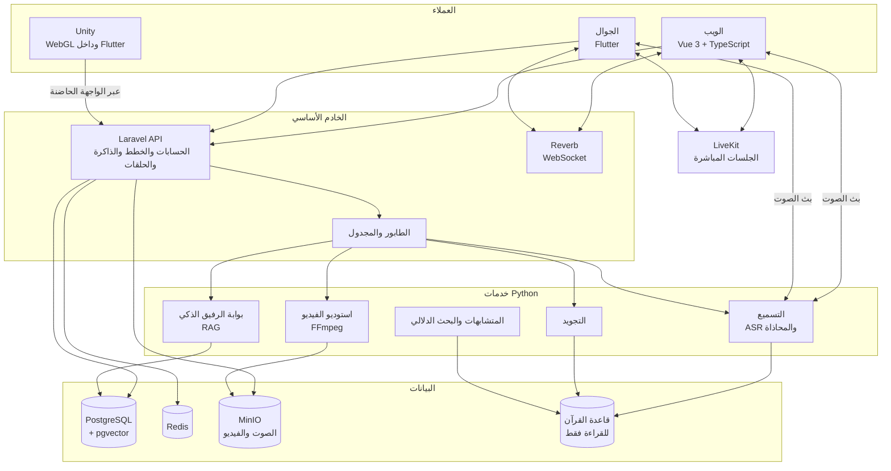
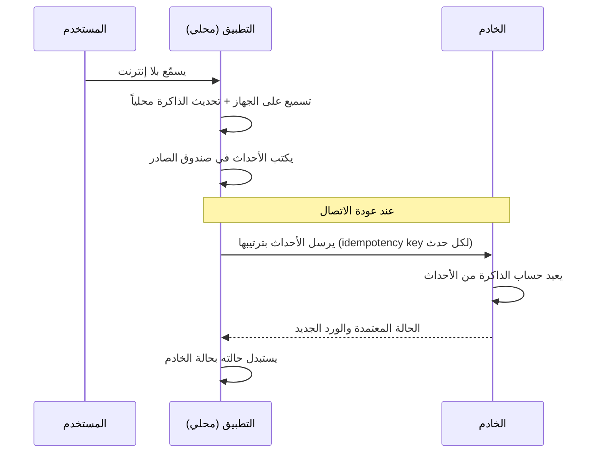

# 03. البنية التقنية

## 1. الصورة الكاملة



## 2. من يملك ماذا

| المكوّن | يملك | لا يفعل |
|---|---|---|
| **Laravel** | كل القواعد: الخطة، ونموذج الذاكرة، وبوابة الإتقان، والصلاحيات | لا يعالج الصوت |
| **Python** | تحويل الصوت إلى «ما قيل ومتى»، وكشف الفروق، وتوليد الفيديو | لا يقرر ما يترتب على الخطأ (يرسل الأخطاء، وLaravel يحدّث الذاكرة) |
| **Vue وFlutter** | العرض والتسجيل والعمل بلا إنترنت | لا منطق تربوي في الواجهة |
| **Unity** | الرسم ثلاثي الأبعاد | لا يتصل بالخادم مباشرة، ولا يحفظ حالة |

**قاعدة:** الواجهات ترسم ما يقوله الخادم. والاستثناء الوحيد المدروس: الجوال بلا إنترنت يشغّل نسخة من محرك الورد والتسميع على الجهاز، ثم يزامن والخادم يعيد الحساب (القسم 6).

## 3. الخادم (Laravel)

- Laravel 12 وPHP 8.4، وPostgreSQL (مع `pgvector`)، وRedis للكاش والطابور، وReverb للأحداث الحية.
- الويب بكوكيز Sanctum، والجوال بتوكن.
- الوحدات (`app/`):

| الوحدة | المسؤولية |
|---|---|
| `Quran` | قراءة النص والصفحات والتلاوات (للقراءة فقط) |
| `Plan` | الخطط، وقوالب الطرق، وورد اليوم، وإعادة التوازن |
| `Memory` | نموذج الذاكرة (FSRS المكيّف)، والدَّين، والترميم |
| `Recitation` | جلسات التسميع، وسجل الأخطاء، وبوابة الإتقان |
| `Writing` | تمارين الكتابة وتصحيحها |
| `Mutashabihat` | المتشابهات وتمارينها |
| `Exam` | الاختبارات ومحاكاة اللجنة |
| `Understanding` | المعاني، والتفاسير، وبطاقات السور، والتدبر |
| `Companion` | الرفيق: التذكير، والتقارير، والمحادثة |
| `Halaqa` | الحلقات، والمعلمون، والتصحيح، والأسرة |
| `Media` | طلبات الفيديو والملفات |

- **نموذج الذاكرة والخطة دوال نقية** (مدخلات ومخرجات بلا قاعدة بيانات) حتى تُختبر وتُنقل إلى Dart للعمل بلا إنترنت بنفس الاختبارات الذهبية.
- الوقت من ساعة واحدة قابلة للتحريك في الاختبار، ويُخزن UTC ويُعرض بتوقيت المستخدم. و«اليوم» عند المستخدم يبدأ من ساعة يحددها (افتراضياً بعد الفجر).

## 4. خدمات Python

خدمة FastAPI واحدة بوحدات، تُفصل لاحقاً عند الحاجة. التفاصيل في [`05-ai-services.md`](05-ai-services.md).

| الوحدة | النمط | الاتصال |
|---|---|---|
| التسميع الحي | بث | WebSocket مباشر من العميل (بتوكن قصير يصدره Laravel) |
| التسميع المسجل | مهمة | من الطابور، والنتيجة webhook موقّع إلى Laravel |
| التجويد | مهمة | بعد التسميع، على نفس التسجيل |
| المتشابهات | دفعة | تُحسب مرة عند بناء البيانات |
| الفيديو | مهمة طويلة | طابور منفصل |
| الرفيق الذكي | طلب | Laravel يستدعيها، وهي تسترجع المصادر ثم تنادي النموذج |

## 5. الويب (Vue)

- Vue 3 وTypeScript وVite وPinia وVue Router، وTailwind بألوان من ملف tokens واحد.
- PWA: يعمل المصحف والورد بلا إنترنت (Service Worker وIndexedDB).
- التسجيل بـ `AudioWorklet` وإرسال PCM 16kHz على WebSocket.
- Unity WebGL يُحمَّل عند الطلب فقط (لا يثقل أول فتح).
- العقد من `openapi.yaml` وتُولَّد منه الأنواع.

## 6. الجوال (Flutter)

- Riverpod وgo_router، وقاعدة محلية **Drift (SQLite)**، وقاعدة القرآن مضمّنة في التطبيق.
- **بلا إنترنت أولاً:** كل جلسة تُكتب محلياً ثم تُزامن.



- **المزامنة بالأحداث لا بالحالة:** الجهاز يرسل «ما حدث» (جلسات وأخطاء)، والخادم مصدر الحقيقة للحالة، فلا تتعارض الأجهزة.
- التسميع على الجهاز بنموذج ONNX مصغّر (M17)، ويُعاد فحص التسجيل على الخادم عند الاتصال إن وافق المستخدم.
- Unity داخل التطبيق كمكتبة (Unity as a Library) تُفتح عند الطلب.
- الإشعارات محلية مجدولة (تعمل بلا إنترنت) ومعها FCM.

## 7. Unity

- مشروع واحد يُبنى مرتين: WebGL للويب، ومكتبة لأندرويد وiOS.
- يتلقى حالته JSON من الواجهة الحاضنة (`journey_state`) ويرسل أحداثاً بسيطة («فتح سورة كذا»). التفاصيل في [`08-unity.md`](08-unity.md).

## 8. الجلسات المباشرة

LiveKit مفتوح المصدر على خادمنا (WebRTC). الصوت أساسي، والفيديو اختياري ومغلق افتراضياً. والمصحف المشترك يتزامن عبر قناة بيانات (المعلم يعلّم على الكلمة فتظهر عند الطالب).

## 9. التشغيل

| الخدمة | الصورة | ملاحظات |
|---|---|---|
| `app` | Laravel (FrankenPHP) | الـ API والويب المبني |
| `queue` و `scheduler` | نفس الصورة | الطابور والمهام المجدولة |
| `reverb` | نفس الصورة | الأحداث الحية |
| `ai` | Python | التسميع والتجويد، وهي الأثقل |
| `video` | Python + FFmpeg | طابور منفصل حتى لا يزاحم التسميع |
| `livekit` | LiveKit | من M19 |
| `postgres` و `redis` و `minio` | رسمية | نسخ احتياطي يومي |

**العتاد:** التسميع الحي هو المحدد. نموذج صغير مكمَّم (quantized) يخدم عدداً محدوداً من الجلسات المتزامنة على معالج عادي، وكرت شاشة واحد يرفعها كثيراً. والحل الأرخص: **التسميع على جهاز المستخدم أولاً** (الجوال من M17، والمتصفح بـ WebAssembly وWebGPU حيث أمكن)، والخادم احتياط. يُقاس الفعلي في M08 قبل أي التزام (قرار صاحب المشروع رقم 6).

## 10. الأمان والخصوصية

- التسجيلات مشفرة في التخزين، وروابطها موقّعة قصيرة العمر.
- المستخدم يختار: حفظ التسجيلات، أو حذفها بعد التحليل (الافتراضي: تُحذف بعد 30 يوماً).
- حسابات الصغار بموافقة ولي الأمر وبلا تواصل مفتوح.
- لا طرف ثالث يتتبع، ولا إعلانات.
- التفاصيل في [`10-content-and-trust.md`](10-content-and-trust.md).

## 11. هيكل المستودع المقترح

```
mutqin/
  backend/      Laravel
  web/          Vue
  mobile/       Flutter
  ai/           Python: asr, tajweed, similarity, companion
  video/        Python + FFmpeg: القوالب والمولّد
  unity/        مشروع Unity
  data/         سكربتات استيراد بيانات القرآن وفحصها (البيانات نفسها لا تُرفع)
  docs/         هذه الملفات + openapi.yaml + tokens.json
  sprints/
  deploy/       Docker Compose
```
