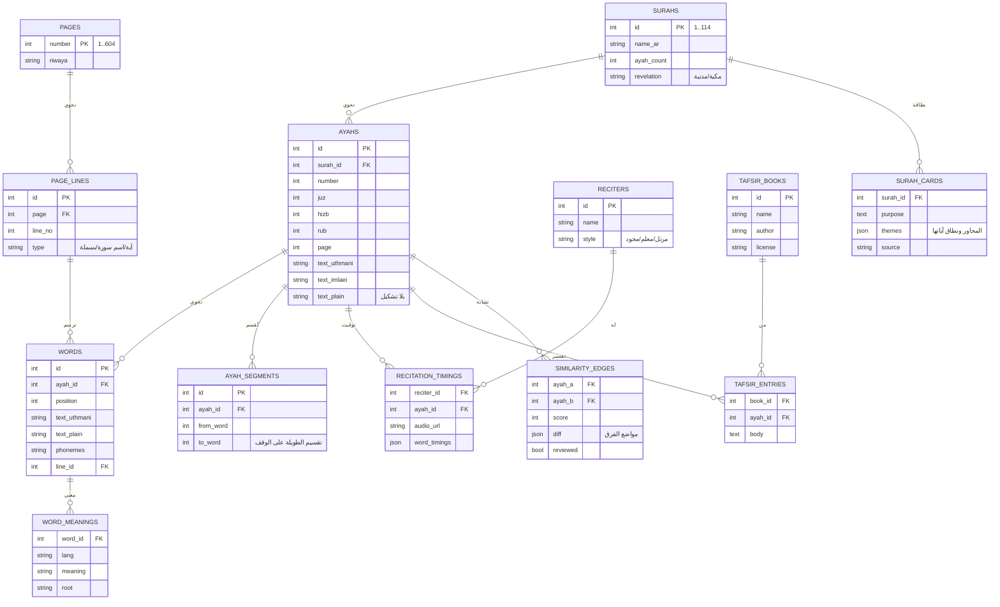
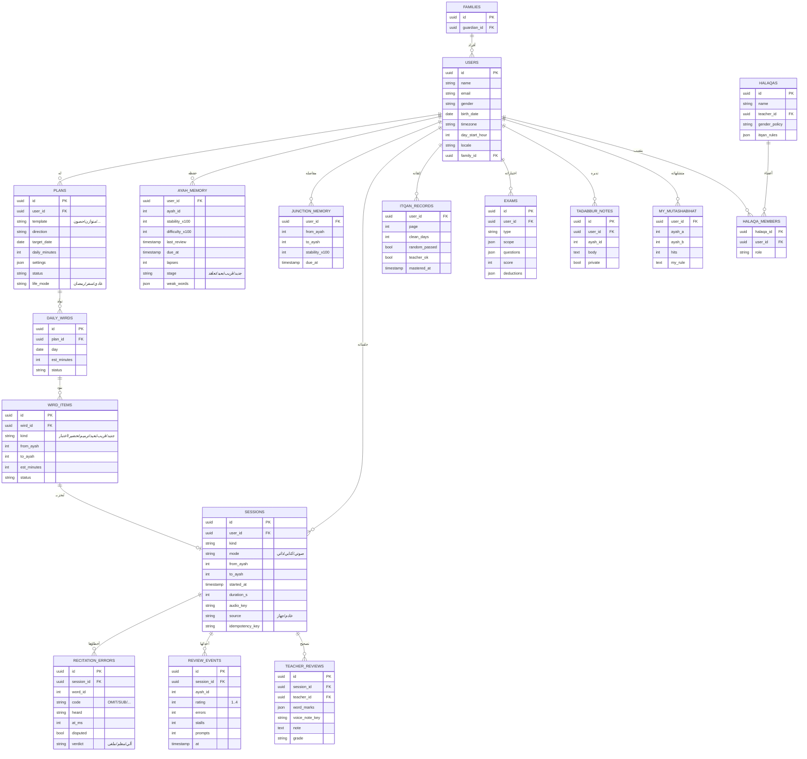

# 04. نموذج البيانات والـ API

## 1. قاعدتان

- **قاعدة القرآن** (للقراءة فقط، نفسها على الخادم وداخل التطبيق): النص، والصفحات، والتلاوات، والتفاسير. تُبنى بسكربتات `data/` وتُفحص ببصمة.
- **قاعدة المستخدمين:** كل ما يخص المستخدم وحفظه.

## 2. قاعدة القرآن

## 3. قاعدة المستخدمين

**ملاحظات:**

- `REVIEW_EVENTS` **سجل لا يُعدَّل**، و`AYAH_MEMORY` تُشتق منه ويمكن إعادة بنائها كاملة (وهذا ما يجعل المزامنة آمنة، وتغيير الخوارزمية لاحقاً ممكناً).
- الأرقام العشرية تُخزن أعداداً صحيحة (`_x100`) حتى يتطابق حساب PHP وDart.
- `idempotency_key` على كل جلسة حتى لا تتكرر عند إعادة الإرسال.
- اعتراض المستخدم (`disputed`) لا يحذف الخطأ بل يعلّمه، ويحسمه المعلم أو إعادة التسميع.

## 4. الـ API (المسارات الرئيسية)

الأساس `/api/v1`، والعقد الكامل `docs/api/openapi.yaml` (يُكتب في M01 ويُحدَّث مع كل مسار).

| المجموعة | المسارات |
|---|---|
| القرآن | `GET /quran/pages/{n}` · `GET /quran/surahs` · `GET /quran/ayahs/{id}` · `GET /quran/search` · `GET /quran/reciters` |
| الحساب | `POST /auth/register` · `POST /auth/login` · `GET /me` · `PATCH /me` · `POST /me/export` · `DELETE /me` |
| التهيئة | `POST /onboarding/known` (ما أحفظه) · `POST /onboarding/placement` (اختبار تحديد المستوى) |
| الخطة | `POST /plans` · `GET /plans/current` · `PATCH /plans/current` · `POST /plans/current/life-mode` · `POST /plans/preview` |
| الورد | `GET /wird/today` · `GET /wird/{date}` · `POST /wird/items/{id}/skip` |
| الجلسات | `POST /sessions` · `POST /sessions/{id}/audio` · `POST /sessions/{id}/finish` · `GET /sessions/{id}` · `POST /sessions/sync` (دفعة من الجوال) |
| التسميع | `POST /recitation/token` (توكن البث) · `POST /recitation/errors/{id}/dispute` |
| الذاكرة | `GET /memory/map` (خريطة الإتقان) · `GET /memory/weak` · `GET /memory/forecast` |
| الكتابة | `POST /writing/check` · `GET /writing/exercise` |
| المتشابهات | `GET /mutashabihat/{ayah}` · `GET /mutashabihat/mine` · `GET /mutashabihat/drill` |
| الاختبارات | `POST /exams` · `POST /exams/{id}/answers` · `GET /exams/{id}` |
| الفهم | `GET /understanding/words/{id}` · `GET /understanding/tafsir/{ayah}` · `GET /understanding/surahs/{id}/card` |
| التدبر | `GET/POST /tadabbur` |
| الرفيق | `GET /companion/today` · `POST /companion/chat` · `GET /reports/weekly` |
| الحلقات | `POST /halaqas` · `POST /halaqas/{id}/join` · `GET /halaqas/{id}/board` · `POST /sessions/{id}/submit` · `POST /reviews` |
| المباشر | `POST /live/rooms` · `POST /live/rooms/{id}/token` |
| الوسائط | `POST /videos` · `GET /videos/{id}` |
| Unity | `GET /journey/state` |

**شكل الخطأ:** `{message, code, errors?}` برسالة بلغة المستخدم.

## 5. الأحداث الحية

| القناة | الحدث | من يسمع |
|---|---|---|
| `user.{id}` | `wird.updated` · `session.analyzed` · `video.ready` · `review.received` | صاحب الحساب |
| `halaqa.{id}` | `member.submitted` · `exam.assigned` | أعضاء الحلقة |
| WebSocket التسميع | `word.ok` · `word.error` · `position` · `stall` | جلسة التسميع نفسها |
