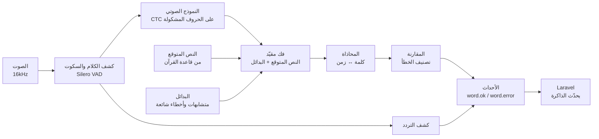
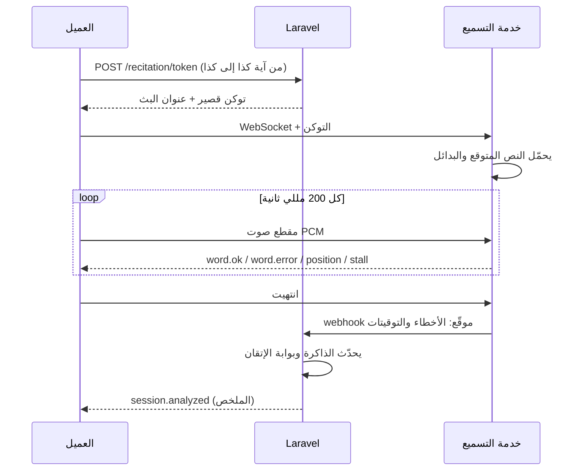
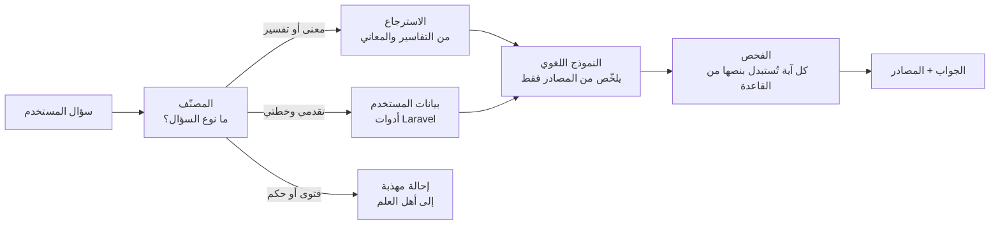

# 05. خدمات الذكاء (Python)

## 1. لماذا التسميع القرآني أسهل وأصعب من التعرف العام على الكلام

- **أسهل:** النص المتوقع معروف مسبقاً (المستخدم يسمّع مقطعاً محدداً)، فالمسألة «مطابقة» لا «إملاء حر».
- **أصعب:** المطلوب كشف فرق كلمة واحدة أو حركة واحدة، والنماذج العامة تميل إلى «تصحيح» ما تسمعه إلى النص المشهور فتخفي الخطأ.

ولذلك لا نعتمد على نموذج إملاء وحده، بل على **محاذاة مقيّدة بالنص مع بدائل محتملة**.

## 2. خط التسميع

| المرحلة | الأداة | الوظيفة |
|---|---|---|
| كشف الكلام | Silero VAD | يفصل الكلام عن السكوت ويقيس مدة التوقف |
| النموذج الصوتي | wav2vec2 أو Whisper مصغّر، مضبوط على تلاوات قرآنية | يخرج احتمالات الحروف (مع التشكيل في مرحلة لاحقة) |
| الفك المقيّد | شبكة حالات من النص المتوقع | كل كلمة لها مسارات: صحيحة، ومحذوفة، وبديلة، وقفزة إلى متشابه |
| المحاذاة | CTC forced alignment | زمن بداية كل كلمة ونهايتها |
| المقارنة | خوارزمية فروق على الكلمات | تصنف: `OMIT` و`SUB` و`ADD` و`ORDER` و`JUMP` و`REPEAT` |
| التردد | من VAD والمحاذاة | سكوت فوق العتبة = `STALL` |

**البدائل (سر الدقة):** عند كل موضع يُضاف إلى شبكة الفك:

1. الكلمات التي تأتي في الآيات المتشابهة عند نفس الموضع (من `SIMILARITY_EDGES`)،
2. الأخطاء التي وقع فيها هذا المستخدم سابقاً هنا،
3. الأخطاء الشائعة عند المستخدمين في هذا الموضع (بعد جمع بيانات كافية وبموافقتهم).

فإذا قال القارئ البديل، يلتقطه النموذج بدل أن «يصححه».

## 3. مراحل النضج

| المرحلة | ما يُكشف | السبرنت | الثقة |
|---|---|---|---|
| 1 | الحذف والإبدال والزيادة والترتيب على مستوى الكلمة (بلا تشكيل)، والتردد | M08 | عالية |
| 2 | التسميع الحي، وتتبع الموضع، والقفز إلى متشابه | M09 | عالية |
| 3 | أخطاء الحركات (اللحن الجلي) | M16 | متوسطة، وتُعرض «يُحتمل» |
| 4 | أحكام تجويد محددة: المدود، ثم الغنة، ثم القلقلة | M16 | متوسطة |
| 5 | المخارج والصفات | M30 (بحث) | منخفضة، والمعلم هو المرجع |

**مبدأ العرض:** كل تنبيه له درجة ثقة. العالية تُعرض خطأً، والمتوسطة «راجع هذا الموضع»، والمنخفضة لا تُعرض للمستخدم وتُحفظ للمعلم.

## 4. القياس قبل الاعتماد

لا تُفعَّل مرحلة للمستخدمين حتى تجتاز **مجموعة اختبار مرجعية**:

- تسجيلات حقيقية (رجال، ونساء، وصغار، ولهجات، وجودة ميكروفون متفاوتة) فيها أخطاء معلَّمة يدوياً من قارئ متقن،
- وتسجيلات بلا أخطاء لقياس الإنذار الكاذب.

| المقياس | الهدف للمرحلتين 1 و2 |
|---|---|
| كشف خطأ الكلمة (recall) | 95% على الأقل |
| الإنذار الكاذب (لكل 100 كلمة صحيحة) | 3 على الأكثر |
| خطأ تتبع الموضع | أقل من 1% من الجلسات |
| زمن التنبيه في البث | أقل من 1.5 ثانية |

والأمر `python -m ai.eval` يطبع الجدول، ويُشغَّل قبل أي تغيير في النموذج (لا يُدمج إن نزلت الأرقام).

## 5. البروتوكول الحي

## 6. التسميع على الجهاز

- نفس النموذج مصدَّراً إلى ONNX ومكمَّماً (int8)، بحجم مستهدف أقل من 80MB، يعمل بـ ONNX Runtime في Flutter.
- الفك المقيّد والمقارنة مكتوبان مرة واحدة (C++ أو Rust) ويُستعملان في Python وFlutter، حتى تتطابق النتائج.
- على الأجهزة الضعيفة: تسجيل ثم تحليل بعد الانتهاء بدل البث.

## 7. تصحيح الكتابة

لا يحتاج نموذجاً: تطبيع النص (توحيد الألف والهمزات والتاء المربوطة، وإسقاط التشكيل حسب مستوى التمرين) ثم خوارزمية فروق على الكلمات، وتصنيف الفرق: إملائي (يُتسامح معه) أو حفظي (يُحسب). ومكانه Laravel (`Writing`) لا Python.

## 8. المتشابهات

تُحسب مرة عند بناء البيانات:

1. تطبيع النص ثم مطابقة n-gram بين كل الآيات (تشابه البدايات، والنهايات، والجمل الداخلية).
2. درجة تشابه، ومواضع الفرق بالكلمة.
3. تصنيف: متطابقة، أو فرق كلمة، أو فرق ترتيب، أو تشابه بداية فقط.
4. مراجعة يدوية لأعلى الدرجات مقابل كتب المتشابهات المعروفة (`reviewed`).

والبحث الدلالي (آيات في نفس المعنى) بتضمينات نصية في `pgvector` للفهم والتدبر، لا للحفظ.

## 9. الرفيق الذكي

**قيود ثابتة:**

- النموذج لا يكتب نص آية: يذكر مرجعها (`2:255`) والخادم يضع النص من القاعدة.
- كل جملة تفسيرية معها مصدرها (الكتاب والموضع)، وإن لم يجد مصدراً يقول «لا أعلم».
- لا فتوى ولا ترجيح بين أقوال.
- تعديل الخطة عبر أدوات محددة (`plans.preview`) ولا يُنفَّذ إلا بموافقة المستخدم.
- واجهة موحدة فوق المزوّد حتى يُبدَّل النموذج بلا تغيير في الكود.

## 10. البيانات والتدريب

- البداية بنماذج مفتوحة مضبوطة على القرآن، وتلاوات القراء المتاحة بتوقيتاتها.
- تسجيلات المستخدمين لا تدخل التدريب إلا **بموافقة صريحة منفصلة** يمكن سحبها، وتُفصل عن الهوية.
- اعتراضات المستخدمين وتصحيحات المعلمين أثمن بيانات للتحسين (M30).
