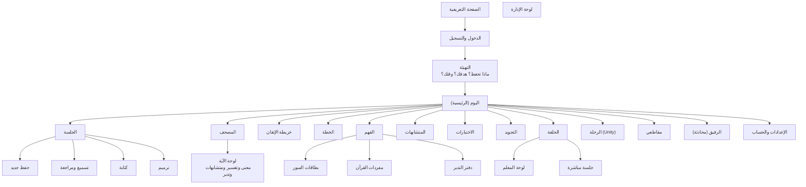

# 06. تصميم الويب

المخططات هنا هيكلية (wireframes) تحدد المحتوى والترتيب، والتصميم البصري النهائي يُعتمد في M03. الواجهة عربية من اليمين إلى اليسار، والمخططات مرسومة تقريبياً.

## 1. خريطة الموقع



## 2. الإطار

- **الكمبيوتر:** شريط جانبي على اليمين (اليوم، المصحف، الخريطة، الفهم، الحلقة، المزيد)، والمحتوى في الوسط، والرفيق لوحة تنزلق من اليسار.
- **الجوال (المتصفح):** شريط سفلي بخمسة أقسام، وزر الجلسة في المنتصف.
- **الجلسة والمصحف** يملآن الشاشة بلا أي تشتيت.

## 3. شاشة «اليوم»

```
+--------------------------------------------------------------+
| السلام عليكم، أحمد                      الثلاثاء 12 رجب      |
| المداومة: 23 يوماً        محفوظك: 4 أجزاء و3 صفحات           |
+--------------------------------------------------------------+
| ورد اليوم                                   ~ 35 دقيقة       |
|                                                              |
|  [ ] تحضير   البقرة 142-145     استماع ومعانٍ      3 د       |
|  [ ] جديد    البقرة 142-145     نصف صفحة          12 د       |
|  [ ] قريب    البقرة ص 20-22     تسميع              8 د       |
|  [x] بعيد    جزء عمّ (الربع 3)  تسميع             10 د       |
|  [ ] ترميم   3 مواضع ضعيفة                         2 د       |
|                                                              |
|                 [   ابدأ الورد   ]                           |
+------------------------------+-------------------------------+
| خريطة الإتقان (مصغّرة)        | الرفيق                        |
| ■■■■□□□□□□ ...               | «أمس تعثرت في آخر ص 21،       |
| أضعف موضع: البقرة 127        |  سنبدأ بها اليوم.»            |
+------------------------------+-------------------------------+
| هذا الأسبوع:  ● ● ● ○ ● ● _      الاختبار القادم: الجزء 2    |
+--------------------------------------------------------------+
```

## 4. جلسة الحفظ الجديد

```
+--------------------------------------------------------------+
| ×  حفظ جديد: البقرة 142-145        الخطوة 4 من 8   ━━━━░░░░ |
+--------------------------------------------------------------+
|                                                              |
|        ﴿ سَيَقُولُ ٱلسُّفَهَآءُ مِنَ ٱلنَّاسِ ... ﴾                    |
|        (الكلمات تختفي تدريجياً مع كل تكرار)                 |
|                                                              |
|   التكرار:  ●●●●●●○○○○   6 من 10                            |
|                                                              |
+--------------------------------------------------------------+
|  [استمع ▶]   [  🎙 أقرأ  ]   [المعنى]   [أخفِ أكثر]         |
+--------------------------------------------------------------+
| الخطوات: استماع ✓ | فهم ✓ | نظر ✓ | آية آية ● | ربط | تسميع |
+--------------------------------------------------------------+
```

## 5. التسميع الحي

```
+--------------------------------------------------------------+
| ×  تسميع: البقرة ص 20-22       وضع التنبيه: [فوري | مؤجل]   |
+--------------------------------------------------------------+
|  صفحة 20                                                     |
|                                                              |
|   وَإِذْ   قَالَ   رَبُّكَ   لِلْمَلَٰٓئِكَةِ   إِنِّى   جَاعِلٌ           |
|   ‾‾‾‾   ‾‾‾‾   ‾‾‾‾‾   ‾‾‾‾‾‾‾‾   ‾‾‾   [خطأ]              |
|   ▒▒▒▒▒  ▒▒▒▒  ▒▒▒▒▒▒  ▒▒▒▒   ▒▒▒▒▒▒▒                       |
|   ▒▒▒▒  ▒▒▒▒▒▒▒  ▒▒▒▒   ▒▒▒▒▒   ▒▒▒                         |
|   (ما قرأته ينكشف، والخطأ بالأحمر، والتردد بالأصفر،         |
|    وما لم تبلغه مخفي)                                        |
|                                                              |
+--------------------------------------------------------------+
|     ((( 🎙 )))  يستمع...      [ذكّرني]   [أعد الآية]  [إنهاء]|
+--------------------------------------------------------------+
```

**بعد الانتهاء (تقرير الجلسة):**

```
+--------------------------------------------------------------+
| تقرير التسميع                               3 صفحات · 7:42   |
+--------------------------------------------------------------+
|  أخطاء: 2      تردد: 3      تلقين: 1      الدرجة: 91         |
|                                                              |
|  1. ص 20 س 6   «جَاعِلٌ» قلتَ «خَالِقٌ»      [▶ اسمع] [لم أخطئ]  |
|  2. ص 21 س 3   انتقلت إلى الأعراف 11       [قارن المتشابه]   |
|                                                              |
|  ص 20: تحتاج تسميعاً نظيفاً ثانياً للإتقان (1 من 3)          |
|  ص 22: متقنة ✓                                               |
|                                                              |
|  [أعد المواضع الضعيفة الآن]            [أرسل للمعلم] [تم]    |
+--------------------------------------------------------------+
```

## 6. خريطة الإتقان

```
+--------------------------------------------------------------+
| خريطة الإتقان       [أجزاء | سور | صفحات]    الحالة اليوم    |
+--------------------------------------------------------------+
|  ج1  ■■■■■■■■■■■■■■■■■■■■   قوي                              |
|  ج2  ■■■■■■■■▣▣▣▣□□□□□□□□   8 متقنة، 4 قريبة                 |
|  ...                                                         |
|  ج30 ■■■■■■▣■■■■■■■■■■■■■   موضع يحتاج ترميماً               |
|                                                              |
|  ■ متقن قوي   ▣ يضعف (يستحق مراجعة)   ▨ ضعيف   □ لم يُحفظ    |
+--------------------------------------------------------------+
|  الضغط على مربع يفتح الصفحة ملونة كلمة كلمة بأخطائك فيها     |
|  التوقع: إن التزمت بوردك، تبلغ الجزء 5 في 14 شعبان           |
+--------------------------------------------------------------+
```

## 7. المصحف ولوحة الآية

```
+----------------------------------+---------------------------+
|          صفحة المصحف             | البقرة 255                |
|   (15 سطراً كالمطبوع)            | [معانٍ][تفسير][متشابه]    |
|                                  | [تدبري][تلاوات]           |
|   لمسة على الآية تفتح اللوحة ←   |                           |
|                                  | ٱلْقَيُّومُ: القائم بنفسه     |
|                                  | المقيم لغيره              |
|                                  |                           |
|  ◀ 43        42        41 ▶      | حالتك: متقنة، آخر تسميع   |
|  [▶ تلاوة] [حفظ] [تسميع] [كتابة] | قبل 6 أيام                |
+----------------------------------+---------------------------+
```

## 8. الخطة

```
+--------------------------------------------------------------+
| خطتي                                          [عدّل] [معاينة]|
+--------------------------------------------------------------+
| الهدف: ختم القرآن حفظاً           الموعد المتوقع: رمضان 1451 |
| القالب: المتوازن                  الاتجاه: من الناس إلى البقرة|
| وقتي اليومي: 40 دقيقة             أيام الراحة: الجمعة        |
| وضع الحياة: [عادي] سفر  مرض  امتحانات  رمضان                 |
+--------------------------------------------------------------+
| توزيع اليوم:   جديد 30%  |  قريب 25%  |  بعيد 40%  | ترميم 5% |
|                                                              |
| ماذا لو؟   وقتي اليومي: [ 40 ]━━●━━  →  الختم: رمضان 1451    |
|            لو 60 دقيقة           →  الختم: شوال 1450         |
+--------------------------------------------------------------+
| المحطات:  ✓ جزء عمّ   ✓ تبارك   ● قد سمع   ○ الذاريات ...    |
+--------------------------------------------------------------+
```

## 9. لوحة المعلم

```
+--------------------------------------------------------------+
| حلقة الفجر · 12 طالباً                    [اختبار] [إعلان]   |
+--------------------------------------------------------------+
| ينتظر تصحيحك (4)                                             |
|  عمر     البقرة ص 30   3:12   آلي: خطآن    [صحّح]            |
|  يوسف    الملك كاملة   4:40   آلي: نظيف    [صحّح]            |
+--------------------------------------------------------------+
| الطلاب        اليوم   الأسبوع   المحفوظ   أضعف موضع          |
|  عمر           ✓      6/7      3 أجزاء   البقرة 177          |
|  يوسف          ✓      7/7      جزآن      -                   |
|  خالد          ✗      2/7      جزء       متأخر 4 أيام  [راسل]|
+--------------------------------------------------------------+
```

**شاشة التصحيح:** التسجيل مع نص الصفحة، وتنبيهات الآلة معلَّمة، والمعلم يضغط على الكلمة ليثبت الخطأ أو يلغيه أو يضيف خطأ تجويد، ويسجل ملاحظة صوتية، ويعطي التقدير.

## 10. قواعد الواجهة

- العربية أولاً وRTL، وخط المصحف للآيات وخط واجهة واضح لغيرها.
- ألوان هادئة (أخضر عميق، وذهبي خافت، وورقي)، ووضع ليلي.
- اللمس 44px على الأقل، وأصغر نص 14px (جمهور فيه كبار سن).
- الأحمر للخطأ فقط، ومعه رمز (لا اعتماد على اللون وحده).
- لا شاشة تُبنى قبل اعتماد تصميمها.
