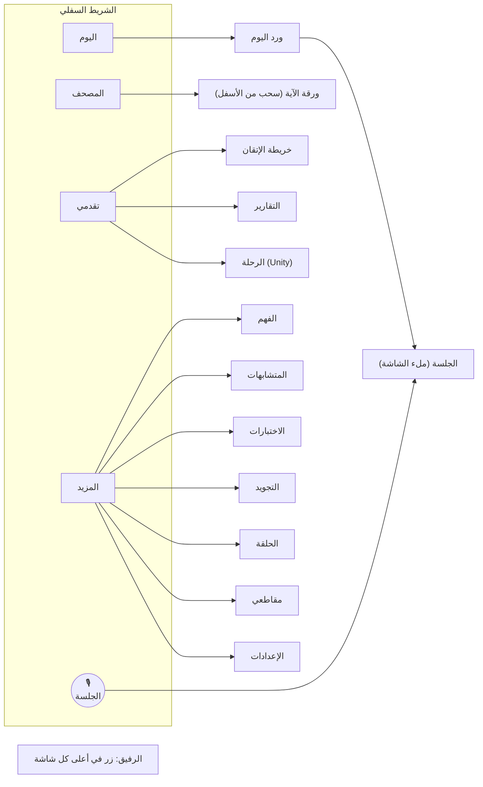

# 07. تصميم الجوال (Flutter)

الجوال هو المنصة الأولى للحافظ: معه في كل وقت، ويعمل بلا إنترنت. والتصميم عمودي (المصحف صفحة عمودية).

## 1. التنقل



## 2. الشاشات الرئيسية

```
   اليوم                  التسميع الحي             ورقة الآية
+---------------+      +---------------+      +---------------+
| السلام عليكم  |      | × ص 20   فوري |      |  صفحة المصحف  |
| المداومة 23   |      |               |      |               |
|---------------|      | وَإِذْ قَالَ رَبُّكَ |      |               |
| ورد اليوم 35د |      | ▒▒▒▒ ▒▒▒ ▒▒▒▒ |      |===============|
| ○ تحضير   3د  |      | ▒▒▒ ▒▒▒▒▒ ▒▒▒ |      | ‾‾‾ البقرة 255|
| ○ جديد   12د  |      | ▒▒▒▒ ▒▒▒ ▒▒▒▒ |      | معانٍ | تفسير |
| ○ قريب    8د  |      |               |      | متشابه | تدبر |
| ✓ بعيد   10د  |      |               |      |               |
| ○ ترميم   2د  |      |   ((( 🎙 )))  |      | القيوم: ...   |
|               |      |               |      |               |
| [ ابدأ الورد ]|      | ذكّرني | إنهاء|      | ▶ حفظ  تسميع  |
|---------------|      +---------------+      +---------------+
| ⌂  ▤  (🎙) ◔ ≡|
+---------------+

   تقدمي                  الوضع السمعي             الحفظ الكتابي
+---------------+      +---------------+      +---------------+
| خريطة الإتقان |      |               |      | أكمل الآية    |
| ج1 ■■■■■■■■■■ |      |   البقرة 142  |      |               |
| ج2 ■■■■▣▣□□□□ |      |               |      | ﴿سيقول ____   |
| ...           |      |   ◉ استمع     |      |  من الناس ___ |
|---------------|      |   ○ ردّد      |      |  ___ عن قبلتهم|
| هذا الأسبوع   |      |   ○ التالي    |      |               |
| ● ● ● ○ ● ● _ |      |               |      | [لوحة مفاتيح] |
| متقن: 6 صفحات |      | (شاشة مظلمة،  |      | [اللوح باليد] |
| أضعف: ص 21    |      |  أزرار كبيرة، |      |               |
| [تقرير كامل]  |      |  أوامر صوتية) |      | [تحقق]        |
+---------------+      +---------------+      +---------------+
```

## 3. ما يتميز به الجوال

| الميزة | الوصف |
|---|---|
| **بلا إنترنت كامل** | المصحف، والتلاوات المحمّلة، والورد، والتسميع على الجهاز، والكتابة |
| **الوضع السمعي** | للسيارة والمشي: استمع ثم ردد، بأوامر صوتية («التالي»، «أعد»)، ومع CarPlay وAndroid Auto لاحقاً |
| **الإشعارات الذكية** | في الوقت الذي اعتدت القراءة فيه، وتتأخر تلقائياً إن كنت في وضع سفر |
| **الودجت** | ورد اليوم على الشاشة الرئيسية، وآية اليوم من محفوظك للمراجعة الخاطفة |
| **المراجعة الخاطفة** | دقيقتان: آية من أضعف مواضعك، أكملها |
| **اللوح** | كتابة باليد أو القلم ثم المحو |
| **الاهتزاز عند الخطأ** | في التسميع والشاشة مقلوبة أو مطفأة |
| **الساعة** | لاحقاً (M30): عدّاد تكرار وتنبيه |

## 4. إدارة التحميل

- التطبيق يأتي بالنص وصفحات المصحف (خط لا صور) فحجمه صغير.
- التلاوات تُحمَّل حسب الخطة تلقائياً: ورد الأسبوع القادم لقارئك المفضل، على الواي فاي.
- نموذج التسميع يُحمَّل مرة بعد التثبيت (مع بديل: التسميع عبر الخادم).
- شاشة «التخزين» تعرض ما حُمِّل وتتيح حذفه.

## 5. المزامنة

كما في `03-architecture.md` القسم 6: الجهاز يرسل الأحداث، والخادم يحسم. وفي أعلى الشاشة مؤشر صغير: «مزامَن» أو «3 جلسات تنتظر الاتصال»، ولا يتوقف شيء على الاتصال.

## 6. البنية

```
mobile/lib/
  core/        الشبكة، والتخزين (Drift)، والمزامنة، والصوت
  quran/       قاعدة القرآن ورسم الصفحة
  engine/      نسخة Dart من محرك الورد والذاكرة (بنفس الاختبارات الذهبية)
  asr/         التسميع على الجهاز (ONNX Runtime + المكتبة المشتركة)
  features/    today, session, mushaf, progress, understanding, halaqa, ...
  ui/          المكونات والألوان من tokens.json
```

## 7. قواعد

- نفس الألوان والمكونات والمصطلحات كالويب (`tokens.json` واحد).
- شاشة الجلسة لا تُطفأ أثناء التسميع، والتسجيل يستمر والشاشة مقفلة في الوضع السمعي.
- إذن الميكروفون يُطلب عند أول تسميع مع شرح، لا عند فتح التطبيق.
- اللوحي: المصحف صفحتان متقابلتان بالعرض.
