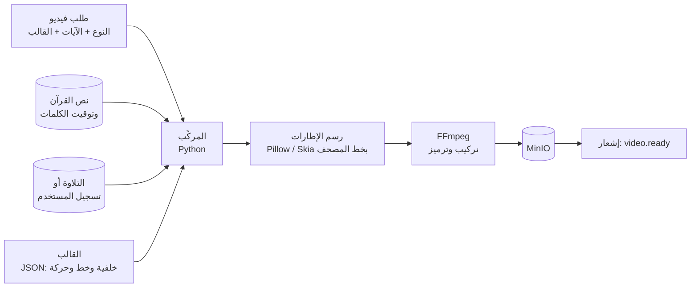

# 09. استوديو الفيديو

مونتاج آلي كامل على الخادم: المستخدم يختار، والخادم يركّب الفيديو ويرسله. لا يحتاج المستخدم برنامج مونتاج.

## 1. لماذا الفيديو؟

- **للحفظ:** مقطع الآيات بنص متزامن يُشاهد مراراً، وهو وسيلة حفظ بصرية سمعية.
- **للتثبيت:** مقاطع المتشابهات متقابلة.
- **للتحفيز:** ملخص تقدمك، ومقطع بصوتك.
- **للتعليم:** دروس التجويد وبطاقات السور.
- **للحلقات:** قوالب جاهزة للمعلم.

## 2. خط الإنتاج



| المرحلة | الأداة | الوظيفة |
|---|---|---|
| التركيب | Python | يحوّل الطلب إلى خط زمني: أي كلمة تظهر متى |
| رسم النص | Pillow أو Skia مع HarfBuzz | يرسم الآية بخط المصحف رسماً صحيحاً (تشكيل واتصال) |
| الحركة | MoviePy، وManim للدروس | تظليل الكلمة، وانتقالات هادئة، ورسوم توضيحية |
| التركيب النهائي | FFmpeg | دمج الصورة والصوت والترميز (H.264، ومقاسات 9:16 و1:1 و16:9) |
| الخلفيات | Blender (لقطات تُصنع مرة) ومكتبة مجانية الترخيص | طبيعة، وهندسة إسلامية، وألوان سادة |
| لقطات Unity | تسجيل من عالم الرحلة | نمو بستانك في ملخص التقدم |

كلها أدوات مجانية مفتوحة.

## 3. أنواع المقاطع

| الرمز | النوع | المحتوى | السبرنت |
|---|---|---|---|
| L1 | **مقطع الحفظ** | الآيات بتلاوة قارئ، والكلمة تتظلل مع النطق، مع خيار التكرار | M24 |
| L1ب | **مقطع الاختبار الذاتي** | الآية تظهر ناقصة، ثم صمت لتكمل، ثم الجواب | M24 |
| L2 | **ملخص التقدم** | أسبوعي وسنوي: أرقامك، وخريطة الإتقان تتلون، وبستانك ينمو | M24 |
| L3 | **بصوتك** | تسميعك المتقن مع النص المتزامن، لنفسك أو لأهلك | M24 |
| L4 | **درس تجويد** | الحكم، ومثاله من القرآن، وموضعه ملوناً، وحركة المخرج من Unity | M25 |
| L4ب | **بطاقة السورة** | مقصدها ومحاورها وخريطة موضوعاتها في دقيقة | M25 |
| L5 | **المتشابهات** | الآيتان متقابلتين، والفرق يُبرز، والتلاوتان متتاليتين | M25 |
| L6 | **قوالب الحلقة** | إعلان، وتكريم طالب، وواجب الأسبوع | M25 |

## 4. الضوابط

- **النص:** من قاعدة القرآن فقط وبخط المصحف، ولا تُقطع آية في موضع يخل بالمعنى (القطع على علامات الوقف فقط).
- **الصوت:** لا موسيقى ولا مؤثرات على التلاوة، ولا تغيير في سرعتها داخل الفيديو المنشور.
- **الخلفيات:** بلا ذوات أرواح، وبلا ما يشغل عن الآية.
- **المشاركة:** «بصوتك» خاص افتراضياً، ومشاركته بقرار صاحبه. ومقاطع الصغار والنساء لا تُنشر من المنصة.
- **حقوق التلاوات:** لا يُستعمل في الفيديو إلا تلاوة ترخيصها يسمح (`10-content-and-trust.md`).

## 5. التشغيل

- طابور منفصل وخدمة `video` مستقلة حتى لا تزاحم التسميع.
- حد يومي لكل مستخدم، وأولوية للمقاطع القصيرة.
- مقاطع الحفظ العامة (بقارئ وقالب معينين) تُولَّد مرة وتُخزَّن للجميع.
- الزمن المستهدف: مقطع دقيقة في أقل من دقيقة معالجة.

## 6. مثال قالب

```json
{
  "id": "calm-green",
  "aspect": "9:16",
  "background": { "type": "video", "asset": "leaves-loop.mp4", "dim": 0.45 },
  "font": { "family": "mushaf", "size": 64, "color": "#FFFFFF" },
  "highlight": { "mode": "word", "color": "#E6C46A" },
  "show": ["surah_name", "ayah_number"],
  "transition": "fade",
  "repeat_each_ayah": 1
}
```
